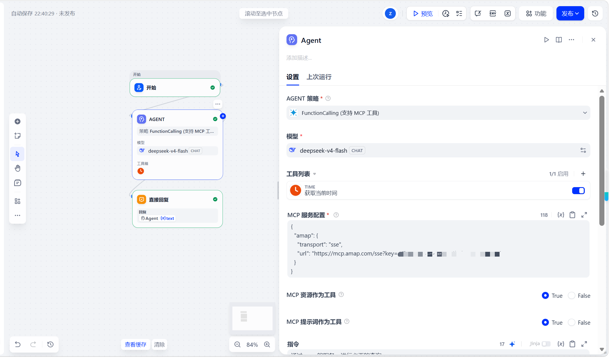

# 高德地图 MCP 智能体 (AMap MCP Agent)

这是一个基于 **Dify** 搭建的智能出行助手，核心亮点是采用了最新的 **MCP (Model Context Protocol)** 协议与 **Function Calling** 策略，实现了大模型与外部地图服务的标准化对接。

## 💡 核心架构与亮点 (Core Features)

1. **MCP 协议接入 (Model Context Protocol)**
   通过配置高德官方的 MCP Server（SSE 传输模式），让 Agent 能够以标准化的方式获取外部实时数据，摆脱了传统的繁琐 API 编写过程。
2. **Function Calling 策略**
   使用了 `FunctionCalling` 作为 Agent 策略，当用户输入出行需求时，模型能自主判断需要调用哪些高德工具（如地点检索、路径规划），并自动提取参数。
3. **工具编排**
   结合了 `TIME`（获取当前时间）和 `AMAP`（高德地图）工具，能够处理“帮我查一下明天下午去某地的路线”这类需要时间推算和地理位置的复合指令。

## 🖼️ 工作流架构 (Workflow Structure)

*工作流逻辑：用户输入 -> Agent 节点 (内置 FunctionCalling 策略及 MCP 工具) -> 直接回复。*

## 🚀 快速开始 (Quick Start)

###导入 DSL 文件
1. 下载本仓库中的 `amap-mcp-agent.yml` 文件。
2. 登录您的 Dify 账号，在“工作室”选择 **“导入 DSL 文件”**。
3. **⚠️ 必做步骤**：
   - 配置模型 API Key。
   - **获取高德免费 Key**：前往[高德开放平台](https://lbs.amap.com/)注册并申请一个 Web 服务 API Key。
   - **修改 MCP 配置**：在 Agent 节点的 `MCP 服务配置` 中，将 URL 里的 `key=你的高德API_KEY` 替换为你自己申请的真实 Key。

## 🛠️ 技术栈 (Tech Stack)
- **平台**: Dify
- **底层模型**: deepseek-v4-flash
- **核心节点**: Agent (FunctionCalling + MCP 策略)。
- **外部服务**: 高德地图 MCP Server。

## 📄 License
This project is licensed under the MIT License.
